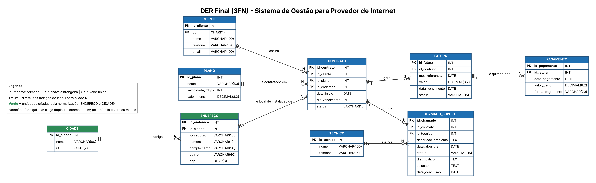

# Banco de Dados para Provedor de Internet

Projeto de modelagem e manipulação de dados de um provedor de internet fictício (NetVeloz), desenvolvido na disciplina de Modelagem de Banco de Dados do curso de Engenharia de Software. Cobre o caminho completo: levantamento do mini-mundo, DER, normalização até a 3FN e scripts SQL (DDL e DML) em MySQL.



## Escopo
O sistema trata da parte administrativa e comercial do provedor: cadastro de clientes e contratos, cobrança mensal (faturas e pagamentos) e suporte técnico (chamados). A rede física (cabos, antenas e roteamento) está fora do escopo.

## Modelo
O modelo lógico tem 9 tabelas, todas em 3FN, e relacionamentos 1:N. A tabela `contrato` resolve a relação N:M entre cliente e plano.

| Tabela | Descrição |
|---|---|
| `cidade` | Cidades atendidas (nome e UF) |
| `endereco` | Endereço de instalação (FK para cidade) |
| `cliente` | Dados cadastrais (CPF único) |
| `plano` | Planos de internet (velocidade e valor mensal) |
| `contrato` | Vínculo entre cliente, plano e endereço |
| `fatura` | Cobrança mensal de cada contrato |
| `pagamento` | Pagamentos (inclusive parciais) de uma fatura |
| `tecnico` | Técnicos de suporte |
| `chamado_suporte` | Chamados de suporte técnico |

A evolução do modelo (do DER inicial ao final) está em [docs/normalizacao.md](docs/normalizacao.md).

## Estrutura do repositório
```
.
├── sql/
│   ├── 01_schema.sql        # cria o banco provedor_db e as tabelas
│   ├── 02_povoamento.sql    # INSERT dos dados de exemplo
│   ├── 03_consultas.sql     # 5 consultas SELECT (JOIN, WHERE, ORDER BY, LIMIT)
│   ├── 04a_updates.sql      # 4 atualizações
│   └── 04b_deletes.sql      # 4 exclusões (respeitando as chaves estrangeiras)
├── docs/
│   ├── der_final_3fn.png    # DER lógico final
│   ├── der_inicial.png      # DER antes da normalização
│   ├── der_final.dot        # fonte do diagrama (Graphviz)
│   ├── normalizacao.md      # análise 1FN, 2FN e 3FN
│   └── cloud-roadmap.md     # próximos passos para levar o projeto à nuvem
└── .github/workflows/
    └── test-sql.yml         # testa os scripts em um MySQL a cada push
```

## Como executar

### Opção 1: MySQL Workbench
Com MySQL 8.x instalado e uma conexão local ativa, abra e execute os arquivos de `sql/` nesta ordem: `01`, `02`, `03`, `04a` e `04b`.

### Opção 2: Docker (sem instalar o MySQL)
No Linux, macOS ou Git Bash:
```bash
docker run --name mysql-provedor -e MYSQL_ROOT_PASSWORD=root -p 3306:3306 -d mysql:8.0
# aguarde alguns segundos para o servidor iniciar
for f in 01_schema 02_povoamento 03_consultas 04a_updates 04b_deletes; do
  docker exec -i mysql-provedor mysql -uroot -proot < sql/$f.sql
done
```
A senha acima é só para um contêiner local e descartável.

### Observações
- A ordem é obrigatória por causa das chaves estrangeiras (erro 1452 ao inserir filho antes do pai; erro 1451 ao apagar pai antes dos filhos).
- O `04b_deletes.sql` apaga registros. Para restaurar o estado inicial: `DROP DATABASE provedor_db;` e execute `01` e `02` novamente.
- Todos os dados de exemplo (nomes, CPFs e e-mails) são fictícios.

## Testes
O workflow em `.github/workflows/test-sql.yml` sobe um MySQL 8.0, executa os cinco scripts em ordem e confere a contagem final de registros de cada tabela.

## Próximos passos
Veja [docs/cloud-roadmap.md](docs/cloud-roadmap.md): execução em um MySQL gerenciado na nuvem, infraestrutura como código e automação de implantação.
